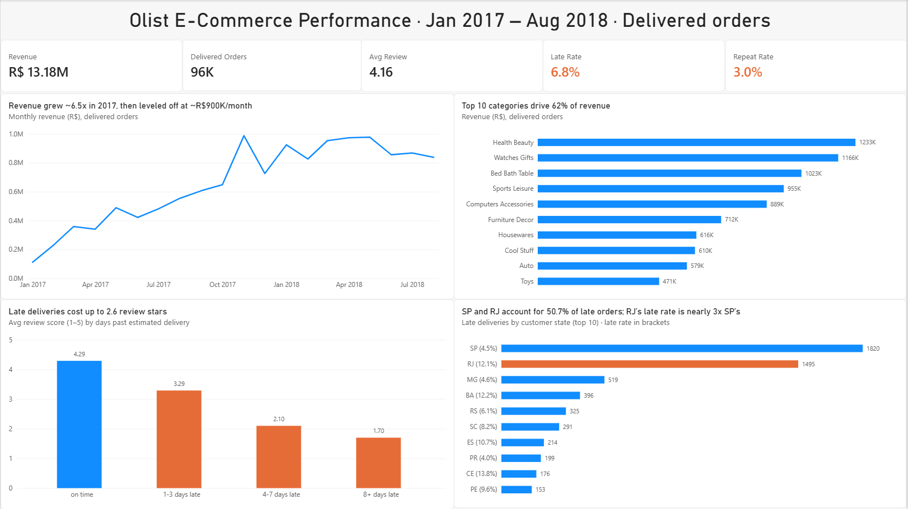
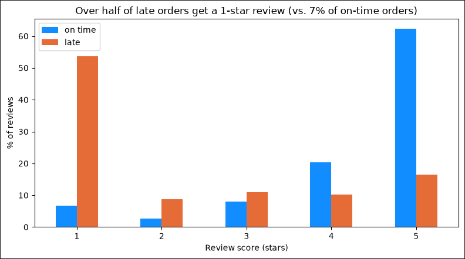

# Olist E-Commerce: Sales, Delivery & Customer Analysis

An end-to-end analysis of ~100,000 orders from Olist, a Brazilian e-commerce marketplace, answering three business questions: **How are sales trending? Where does revenue come from? What is hurting customer satisfaction?**

**Tools:** SQL (SQLite) · Power BI · Excel · Python (pandas, SciPy, matplotlib)



---

## Key Findings

1. **Late deliveries are the biggest driver of bad reviews.** On-time orders average **4.29 stars**; late orders average **2.27**. **54% of late-order reviews are 1-star**, compared with 7% for on-time orders. The damage grows with each day of delay: 3.29 stars (1–3 days late) → 2.10 (4–7 days) → 1.70 (8+ days). The gap is statistically confirmed (Welch's t-test, p < 0.001) and very large (Cohen's d = 1.47).

2. **Half of all late orders come from two states.** São Paulo and Rio de Janeiro account for **50.7% of late orders**. RJ is the second-largest market, and its late rate (**12.1%**) is nearly **3x São Paulo's (4.5%)**. Northeast states have the highest late rates: AL (21.4%), MA (17.4%), SE (15.2%).

3. **Customers are let down by broken promises, not by long waits.** Remote northern states (RR, AP, AM) wait 26–29 days on average, the longest in the country, yet AP and AM have some of the *lowest* late rates (≤3%), because their delivery estimates account for the distance.

4. **Almost no customers come back.** Only **3.0%** of customers placed a second order. The business runs almost entirely on new-customer acquisition.

5. **Revenue grew ~6.5x during 2017**, from R$112K (Jan) to R$726K (Dec), then leveled off at around **R$900K/month** through Aug 2018. The peak month, Nov 2017 (R$988K, +52% vs. October), was driven by Black Friday: **1,176 orders on Nov 24 alone**.

6. **Revenue is concentrated.** The top 10 product categories generate **62% of revenue**, led by Health & Beauty (R$1.23M), Watches & Gifts (R$1.17M) and Bed, Bath & Table (R$1.02M).

7. **Brazilian shoppers pay in installments.** Credit cards account for **78.5% of payment value**, and credit card customers split purchases into **3.5 installments** on average. Every other payment method is paid in a single installment.

## Recommendations

1. **Fix delivery performance in Rio de Janeiro first.** It combines a large customer base with a high late rate (1,495 late orders), so improvements there reach the most customers.
2. **Recalibrate delivery estimates for Northeast states.** The northern states show that customers accept long deliveries when the estimate is honest. More realistic estimates in AL, MA and SE should reduce late orders without needing faster shipping.
3. **Contact customers proactively once an order passes its estimated date.** Over half of late orders end in a 1-star review, so an update, apology or voucher at that moment is the cheapest way to protect ratings.
4. **Invest in retention.** With a 3% repeat rate, even small gains are meaningful: post-purchase emails, a first-reorder discount, and prominent installment options.

---

## Dashboard (Power BI)

Headline KPIs for Jan 2017 – Aug 2018 (delivered orders): **R$13.18M revenue · 96,211 orders · 4.16 average review · 6.8% late rate · 3.0% repeat rate**.

The dashboard answers each business question with one chart, and uses a consistent color scheme: orange marks a problem area. It is built from CSV exports of the SQL queries, plus a DAX calculated column for the state labels. File: `olist_dashboard.pbix`.

## Statistical Test (Python)



`review_analysis.ipynb` loads the delivery and review data directly from the SQLite database with pandas and tests whether the review gap could be due to chance:

| Metric | On time | Late |
|---|---|---|
| Reviews | 89,944 | 6,409 |
| Average score | 4.29 | 2.27 |
| Standard deviation | 1.15 | 1.57 |

- **Welch's t-test:** t = 101.0, p < 0.001
- **Cohen's d:** 1.47, a very large effect (≥ 0.8 is considered large)
- **Caveat:** this is observational data. Late orders may differ in other ways (region, product type), so the result shows a strong association rather than proof of cause.

## Payment Analysis (Excel)

`payments_analysis.xlsx` analyzes ~100K payment records using a pivot table, conditional formatting and `XLOOKUP` (to bring order status onto each payment, so that the analysis uses the same delivered-orders definition as the SQL work). It also contains a cleaning log.

---

## Data

- **Source:** [Brazilian E-Commerce Public Dataset by Olist (Kaggle)](https://www.kaggle.com/datasets/olistbr/brazilian-ecommerce)
- **Size:** ~100K orders from Sep 2016 – Oct 2018, across 9 related tables (orders, customers, order items, payments, reviews, products, sellers, geolocation, category translations)
- The raw data is not included in this repository. Download it from Kaggle (see *How to Reproduce*).

## Data Cleaning Decisions

| Issue found | Decision | Impact |
|---|---|---|
| Orders that were canceled, unavailable or still in progress | Included only `delivered` orders | 96,478 of 99,441 orders kept (97%) |
| Very few orders in 2016 and in Sep–Oct 2018 (collection start-up and export cut-off) | Limited trend analysis to Jan 2017 – Aug 2018 | Avoids a misleading "sales collapse" at the end of the series |
| 8 delivered orders with no delivery date | Kept in revenue figures; excluded from delivery analysis | Under 0.01% of orders |
| `customer_id` changes with every order | Used `customer_unique_id` for all customer metrics | 99,441 customer IDs map to 96,096 actual people |
| Estimated delivery dates are stored at midnight | Compared dates only, using `date()` | Prevents same-day deliveries being counted as late |
| Some orders have more than one review | Counted distinct orders for sample sizes | Avoids inflating group sizes |
| Products with missing or untranslated categories | `COALESCE` to the Portuguese name, or `unknown` | No revenue dropped from category totals |
| Some estimates set months in advance (up to 147 days early) | Kept; counted as on time | Real customer experiences, not errors |
| Payment type `not_defined` | Excluded from payment analysis | 3 rows, all R$0 |
| Payments for orders that weren't delivered | Joined order status with `XLOOKUP`, filtered to delivered | ~3,100 payments removed (103,883 → 100,756) |

## Approach

1. **Load:** `load_data.py` loads the 9 CSV files into a SQLite database and indexes the join keys.
2. **Explore and clean (SQL):** checked order statuses, date coverage, missing values and ID consistency before any analysis.
3. **Analyze (SQL):** answered 5 business questions in `analysis.sql` using joins, CTEs, window functions (`LAG`, `SUM() OVER`), `CASE` bucketing and conditional aggregation.
4. **Validate (Python):** tested the strongest finding statistically and measured its effect size.
5. **Analyze payments (Excel):** pivot table, `XLOOKUP` and conditional formatting.
6. **Visualize (Power BI):** a one-page dashboard with KPI cards and four charts.

## Repository Structure

```
├── README.md
├── load_data.py              # Loads the Kaggle CSVs into SQLite
├── analysis.sql              # Data checks + 5 business questions, with findings
├── review_analysis.ipynb     # Statistical test of late delivery vs. review score
├── payments_analysis.xlsx    # Payment method analysis + cleaning log
├── olist_dashboard.pbix      # Power BI dashboard
├── dashboard_data/           # Query results exported for the dashboard
└── images/
    ├── dashboard.png
    └── review_distribution.png
```

## How to Reproduce

1. Download the dataset from [Kaggle](https://www.kaggle.com/datasets/olistbr/brazilian-ecommerce) and unzip the CSVs into a folder named `data`.
2. Install pandas: `pip install pandas`
3. Build the database: `python load_data.py data`
4. Open `olist.db` in [DB Browser for SQLite](https://sqlitebrowser.org) and run the queries in `analysis.sql`.
5. For the notebook: `pip install jupyter scipy matplotlib`, then `python -m notebook` and open `review_analysis.ipynb`.
